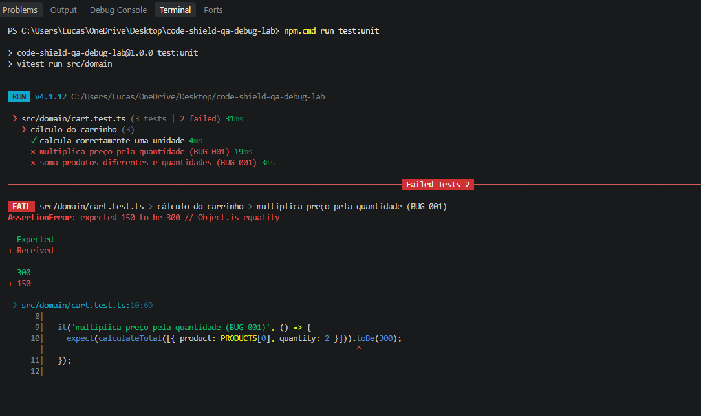
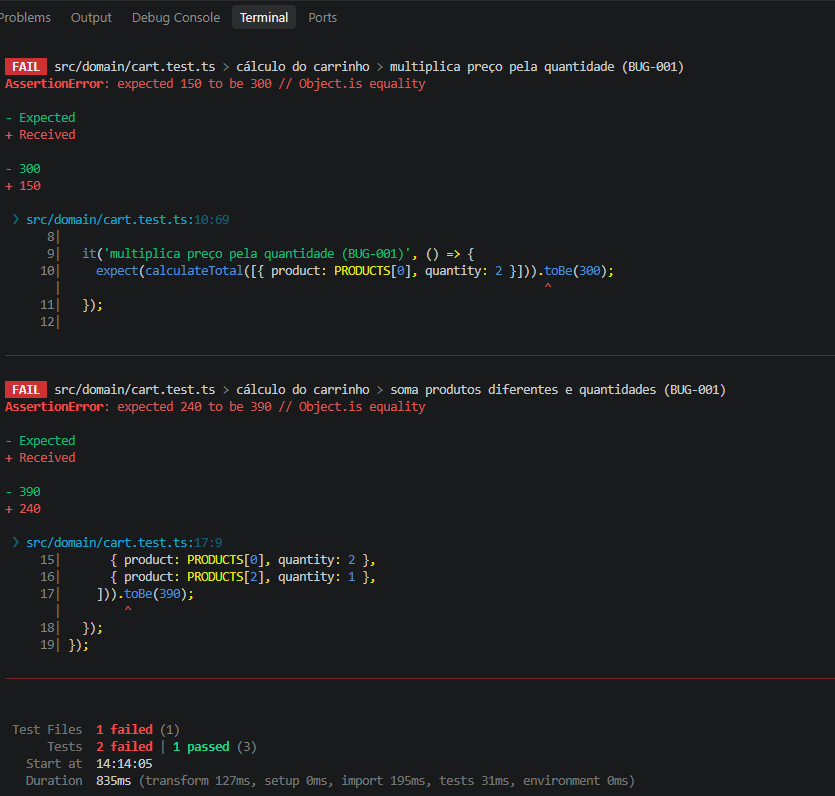
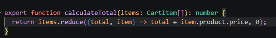
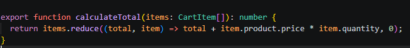
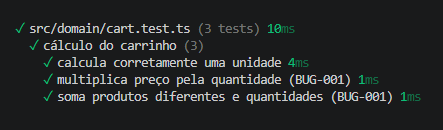
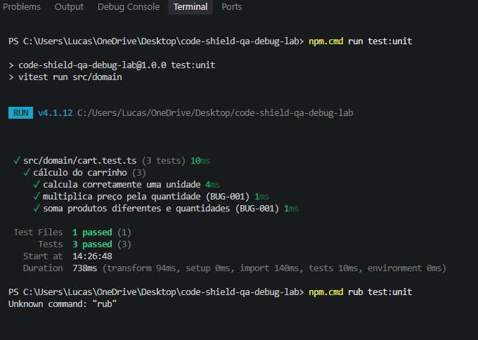

# Evidências — BUG-001 | ShieldMart

> Capturas feitas durante a investigação local do defeito simulado de cálculo do carrinho. A falha foi reproduzida e corrigida antes do primeiro commit remoto. Esta galeria documenta o processo retrospectivamente.

## 1. Reprodução da falha

## 2. Detalhamento das assertions

## 3. Causa raiz no código original

## 4. Correção implementada

## 5. Reteste dos testes unitários

### Captura complementar

**Nota:** após o resultado aprovado na captura complementar, aparece um comando digitado incorretamente (`rub` em vez de `run`). O erro de digitação é posterior aos testes e não afeta seu resultado.

## Vídeo do debugging e teste E2E

- **Vídeo:** gravado localmente; link público ainda pendente.
- **Playwright E2E:** não foi demonstrado por estas capturas; não declarar aprovação sem execução.

[Voltar ao relatório BUG-001](../../BUG-001.md).
